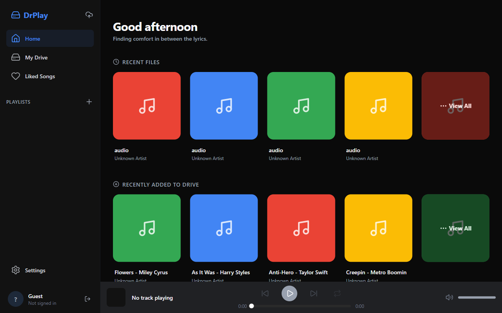
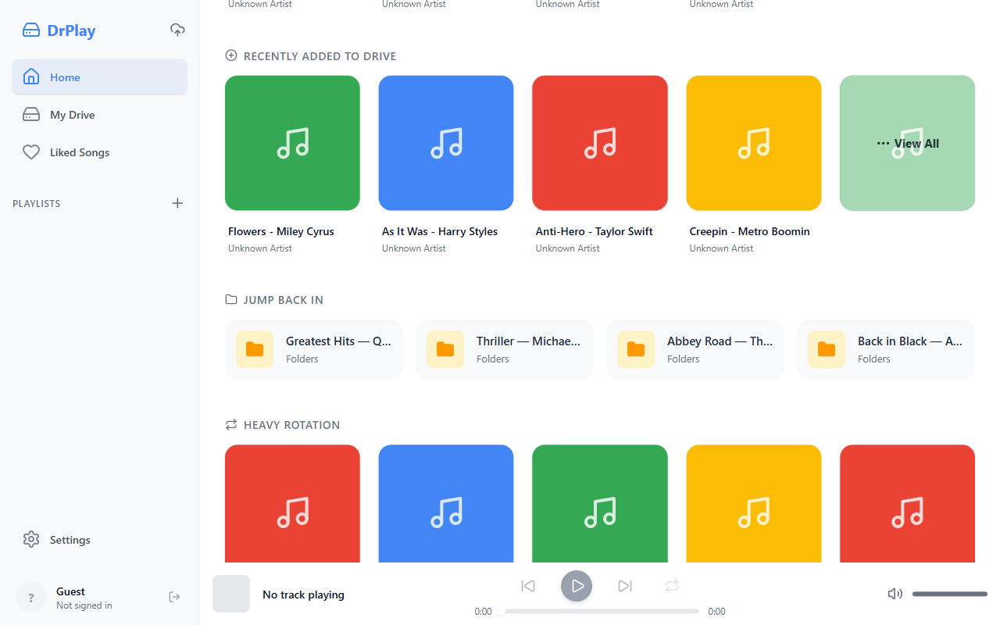
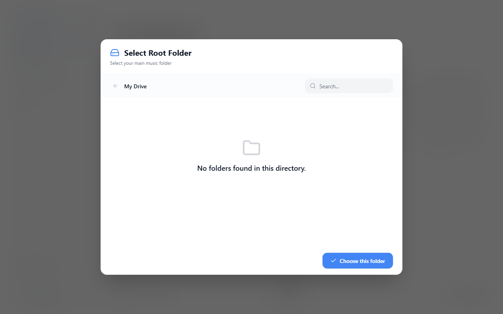
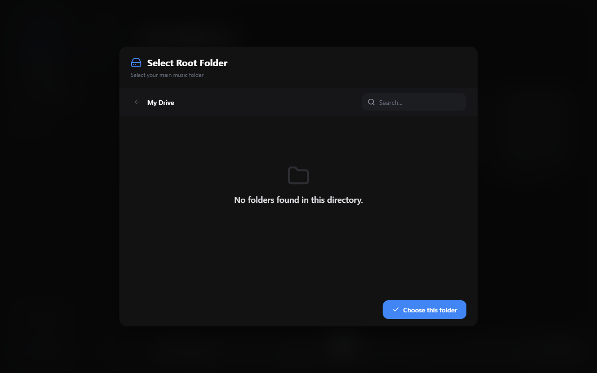

# DrPlay

**A Windows desktop media library for Google Drive. Browse your Drive, stream supported music and video, and keep playback controls and library state in a native app.**

[](https://tauri.app/)
[](https://react.dev/)
[](https://www.typescriptlang.org/)
[](https://github.com/auhsuai/drplay/actions/workflows/build.yml)




<p align="center">
  
  
</p>

> Screenshots are demonstration captures using mock library data. They do not show a real Google account.

DrPlay is a Windows desktop app built with Tauri 2, React, TypeScript, and Rust. It uses Google Drive as the remote media source, maintains a local searchable file/metadata mirror, and uses an mpv-based native playback engine on Windows. The application does **not** need to download an entire library before browsing or starting playback, although optional downloads and background caching can store media data locally.

## Contents

- [What DrPlay can do](#what-drplay-can-do)
- [Supported media](#supported-media)
- [How it works](#how-it-works)
- [Google permissions and privacy](#google-permissions-and-privacy)
- [Local data and cache](#local-data-and-cache)
- [Known limitations](#known-limitations)
- [Install and development setup](#install-and-development-setup)
- [Tests and code quality](#tests-and-code-quality)
- [Project layout](#project-layout)
- [Contributing](#contributing)
- [License](#license)

## What DrPlay can do

### Google Drive library

- Sign in with a Google account through the system browser.
- Browse folders, navigate with breadcrumbs, sort and search the local library mirror, and page through large folder listings.
- Configure an ordered list of library root folders and navigate between them through a virtual root.
- Use a virtualized file list intended to keep scrolling responsive in large libraries.
- Create folders, upload files and folders, download files, move items, and move items to Drive Trash.
- Restore items or permanently delete them from the Trash manager. Ordinary delete operations move items to Trash rather than immediately deleting them permanently.
- Store DrPlay's root-folder configuration in Google Drive's hidden `appDataFolder` so it can survive reinstalling the app.

### Player and library features

- Play/pause, seek, volume, shuffle, repeat, queue management, and next/previous track controls.
- Maintain liked songs, playlists, listening history, playback/session state, and library presentation state locally.
- Provide Home views such as recently added, recent files, heavy rotation, discovery, and resume/jump-back-in content.
- Read media metadata and cache cover art/thumbnails to reduce repeated work.
- Support system-tray behavior, Windows media controls, light/dark themes, English/Vietnamese UI, and a settings screen with cache and error-log tools.
- Synchronize eligible Drive file metadata in the background so the local library can update without requiring a full app reload.

### Local file downloads

DrPlay can download selected content to a user-configured local download directory. Downloaded files are separate from the streaming and metadata caches and can be kept independently of the app's cache lifecycle.

## Supported media

The library currently admits files based on an explicit filename-extension allowlist:

| Type | Extensions included in the library |
|---|---|
| Audio | `.mp3`, `.flac`, `.wav`, `.ogg`, `.m4a`, `.aac`, `.opus` |
| Video | `.mkv`, `.mp4` |

This is the set DrPlay currently indexes as playable media, not a guarantee that every codec/profile inside every file will play on every machine. Actual playback also depends on the bundled mpv/libmpv build, the selected audio/video output path, available hardware decoding, and the Windows environment. A format that mpv could decode in principle may still be excluded from the library until it is explicitly supported by the app's media-type rules and tested through the full streaming path.

## How it works

DrPlay uses a web UI inside a native Tauri window, with Rust responsible for OS integration and native playback services.

```text
React + TypeScript UI
  ├─ Tauri IPC ──────────────> Rust commands
  │                             ├─ Google OAuth / token storage
  │                             ├─ cache, thumbnails, tray, media controls
  │                             └─ local streaming proxy
  ├─ IndexedDB (Dexie)          └─ mpv / libmpv native playback engine
  │                                       │
  └─ Service worker                    HTTP Range requests
      /drive-stream/                       │
      metadata/browser media               ▼
      and persistent byte cache       Google Drive API
```

There are two distinct media-data paths in the codebase; they should not be treated as one shared cache:

1. **Native playback path:** the default Windows engine is in-process `libmpv`. It requests media from a local Rust HTTP proxy bound to `127.0.0.1` on an ephemeral port. The proxy sends authenticated requests to Google Drive, forwards byte-range requests and response headers, handles redirects deliberately, and bounds stalled network requests. A standalone `mpv.exe` sidecar is retained as a fallback.
2. **Service-worker path:** `/drive-stream/{fileId}` fetches media from Google Drive for browser-side media/range and metadata workflows. It includes a persistent IndexedDB byte cache and a best-effort next-track prefetch mechanism. This cache does not automatically warm the native mpv proxy's separate playback path.

### Local library mirror and sync

- File and folder metadata is mirrored locally in IndexedDB for navigation and search.
- Full sync uses paginated Drive API requests; later updates use the Drive Changes API and a stored change cursor.
- The current background delta-sync poll interval is 60 seconds, with an additional refresh trigger when the app regains focus.
- Metadata reads use byte-range requests, request de-duplication, bounded concurrency, retry/backoff, and a circuit breaker to reduce duplicate traffic and avoid hammering Drive when it is throttling.

These are implementation choices intended to improve responsiveness and resilience. They are not substitutes for runtime benchmarks; actual performance depends on library size, Drive/network latency, media encoding, and the local machine.

## Google permissions and privacy

### OAuth and requested scopes

DrPlay opens the system browser for Google OAuth. The native flow uses a dynamically assigned loopback callback port, PKCE with SHA-256, and a random `state` value that is checked when the browser redirects back to the app.

The current implementation requests these scopes:

- `https://www.googleapis.com/auth/drive` — broad access to Drive files, needed by current features that list and manage files across Drive, upload, move, trash, restore, and delete items.
- `https://www.googleapis.com/auth/drive.appdata` — access to DrPlay's app-specific configuration stored in the hidden `appDataFolder`.
- `email` and `profile` — basic Google account identity information used by the app.

**Important:** the `drive` scope is broad. It is not restricted by Google to the folder a user selects inside DrPlay. Configured library roots organize the app's library view; they are not an OAuth security boundary. The current full-sync query indexes eligible media and folders at account scope rather than using the selected roots as a hard query boundary. Users should understand this when granting permission. Narrower access (for example, a redesigned flow based around user-selected files and `drive.file`) would require architectural changes and may affect current library-management features.

The OAuth client configuration is included at build time for a native desktop client. A desktop OAuth client secret cannot be treated as a confidential server-side secret; do not put user access or refresh tokens in source control or issue logs.

### Token handling

- Refresh tokens are normally stored through the operating system credential vault using the `keyring` crate (Windows Credential Manager on Windows).
- The frontend currently maintains a short-lived access-token copy in browser storage for Drive API calls and service-worker coordination.
- For compatibility and resilience, the refresh-token code has a fallback to `localStorage` if keyring access or writes fail, including legacy-token migration. Therefore, it would be inaccurate to claim that a refresh token can *never* be present in browser storage.
- The native streaming proxy also maintains its own in-memory access-token cache. Token ownership and explicit invalidation across frontend, service worker, and native playback are still areas for further hardening.
- Logout attempts to clear local account state and revoke the Google tokens. Revocation and local cleanup are best-effort operations; a failed network request or local storage operation can prevent part of the cleanup from completing.

### Local data, network, and telemetry

- The main remote media and library operations call Google APIs directly; the native proxy is local to the machine and binds to loopback rather than all network interfaces.
- The Tauri Content Security Policy restricts scripts to the app and limits connection/media/image sources to the endpoints and local protocols the app needs.
- The current frontend dependency manifest does not include a third-party analytics SDK. This is not a formal network-traffic certification; runtime traffic has not been independently verified with a packet capture as part of this README update.
- DrPlay uses local application storage and caches. See [Local data and cache](#local-data-and-cache) for the distinction between user library data and cached bytes.

## Local data and cache

| Data | Where it is kept | Notes |
|---|---|---|
| File/folder listing mirror | IndexedDB via Dexie | Metadata used for browsing, search, and sync; not a local copy of every media file. |
| Metadata, likes, playlists, history, and player/UI state | Local app/browser storage, including IndexedDB and browser storage | These are local app state, not a music-history upload service. Root-folder configuration is also synced separately as described below. |
| DrPlay root-folder configuration | Google Drive `appDataFolder`, with local state for startup/navigation | The config is app-specific and hidden from the normal Drive file listing. |
| Cover/thumbnail data | App cache directory and in-memory caches | Managed in part by the cache settings. |
| Service-worker media byte cache | IndexedDB database `drplay-bytes` | Persistent cache capped at 512 MiB with LRU eviction; it stores media bytes, not just URL strings. |
| Explicit downloads | User-selected download directory | These are user files, not disposable cache entries. |
| Error log | Local application storage | The app includes redaction for common token, authorization-header, URL, and file-ID patterns. Redaction reduces risk but is not a guarantee that all sensitive data can never appear in logs. |

### Cache and account-switching caveat

The persistent service-worker media cache is currently keyed by file ID and byte-chunk index rather than by Google account. Cache lifecycle and account isolation need further hardening, and the existing Settings cache manager/logout flow does not provide a guarantee that every stored media byte is purged. **Do not treat logout as secure erasure of cached media on a shared Windows user profile.** This is a known limitation to address before relying on cache separation as a privacy boundary.

Clearing DrPlay caches should not be confused with deleting files from Google Drive. Conversely, moving an item to Drive Trash or permanently deleting it is a Drive operation, not a cache operation.

## Known limitations

- **Shared Drives and resource-key-protected shared files:** the current playback proxy builds the upstream URL from the file ID and does not forward Drive's `resourceKey` parameter. Some shared/link-shared files may appear in listings but fail to play with a `403` or `404`. Shared Drive roots are not fully supported by the current root-selection flow.
- **Root selection versus sync scope:** root folders currently define navigation and presentation, but full sync queries eligible folders/media more broadly across the account. Selecting a root must not be interpreted as restricting the app's granted Google permissions or all metadata queries to that root.
- **Cache isolation and purge:** the persistent service-worker byte cache is not account-namespaced and is not guaranteed to be purged by logout. See the warning above.
- **Native token lifecycle:** the frontend and playback proxy still maintain separate token state. A single native token owner plus explicit logout invalidation is a documented hardening direction, not a behavior to assume is already complete.
- **Codec/container allowlist:** the UI/library only indexes the extensions listed under [Supported media](#supported-media), even if the bundled engine can decode other formats.
- **Offline playback:** browsing cached metadata may still be possible, but streaming requires network access to Google Drive. Only files explicitly downloaded to the local download path are available as standalone local copies.
- **Runtime and build environment:** Windows builds bundle a pinned WebView2 Fixed Version Runtime and mpv/libmpv artifacts. These must be refreshed and verified as part of releases. The mpv source removes old upstream release tags periodically; the fetch script can fall back to the latest release with a warning when the pinned tag disappears, which means such a fallback build is integrity-checked but not fully reproducible from a fixed upstream engine tag.
- **Test claims:** tests exist in both frontend and Rust code. The current GitHub Actions workflow builds the Windows installer but does not itself run the full test/lint suite. Run the relevant commands locally rather than inferring test status from a successful installer build.

## Install and development setup

DrPlay is currently a Windows x64 application. The steps below are for developing and building the application from source, not for installing a signed public release.

### Requirements

- Windows 10 or later, x64.
- Node.js 22 and npm (the current GitHub Actions workflow uses Node 22).
- Stable Rust toolchain and Cargo.
- The Windows C++ build prerequisites required by Tauri 2.
- Google account and a Google Cloud project with the Google Drive API enabled.
- Network access to Google and GitHub to obtain dependencies and the pinned playback/runtime artifacts.

### 1. Clone the repository

```powershell
git clone https://github.com/auhsuai/drplay.git
cd drplay
npm install
```

### 2. Configure Google OAuth

1. Open the [Google Cloud Console credentials page](https://console.cloud.google.com/apis/credentials).
2. Enable the Google Drive API for the project.
3. Create an OAuth client ID of type **Desktop app**.
4. Save the downloaded client configuration at the repository root as `wa_credential.json`.

The file should have the installed-client shape expected by `src-tauri/src/auth.rs`:

```json
{
  "installed": {
    "client_id": "YOUR_CLIENT_ID.apps.googleusercontent.com",
    "client_secret": "YOUR_CLIENT_SECRET"
  }
}
```

`wa_credential.json` is a build input and must not be committed. The GitHub Actions build uses the `GOOGLE_OAUTH_CREDENTIALS` repository secret to create this file during CI.

### 3. Fetch Windows playback/runtime artifacts

Run these scripts in a Windows environment. They stage the mpv sidecar, `libmpv-2.dll`, and the fixed WebView2 runtime referenced by the Tauri bundle configuration:

```powershell
npm run fetch-mpv
npm run fetch-webview2
```

The mpv fetch script checks expected file sizes and SHA-256 digests. If the pinned mpv release has been removed upstream, the script can fall back to the latest release and prints a warning; review that warning rather than silently assuming the build used the pinned engine.

### 4. Run the app or build an installer

```powershell
# Vite frontend only (without the native Tauri shell)
npm run dev

# Native desktop app with frontend hot reload
npm run tauri dev

# TypeScript check + production frontend bundle
npm run build

# Windows MSI installer
npm run tauri build -- --bundles msi
```

A clean native build needs the OAuth file and the downloaded Windows artifacts to be present. The app bundles a Fixed Version WebView2 runtime as configured in `src-tauri/tauri.conf.json`; updating that pinned runtime is a release-maintenance task.

## Tests and code quality

The repository includes Vitest tests for the frontend and Rust unit/integration tests. Useful local checks include:

```powershell
npm test
npm run lint
npm run format:check
npm run i18n:check
cargo test --manifest-path src-tauri/Cargo.toml
```

Run Rust/build commands in the supported Windows environment with the required OAuth build input and native dependencies available. Some tests may be platform-specific. A passing unit-test suite does not replace real-account OAuth testing, runtime network testing, or playback verification on representative hardware.

## Project layout

```text
src/
  ui/                 React screens and components
  hooks/              Auth, Drive navigation, player, sync, and UI hooks
  store/              Shared application/player state
  utils/              Drive API, tokens, metadata, media queries, cache, errors
  workers/             Full/delta sync and background worker logic
  db/                 IndexedDB/Dexie schemas and persistence helpers
public/
  sw.js                Service-worker media/range proxy and byte cache
src-tauri/
  src/auth.rs          Google OAuth flow
  src/token_store.rs   OS credential-vault integration
  src/stream_proxy/    Localhost Drive streaming proxy
  src/player/          In-process libmpv engine and rendering pipeline
  src/mpv/             mpv.exe fallback, IPC, process lifecycle, Job Object
  src/protocol/        Custom app protocol and cover handling
  tauri.conf.json      Window, CSP, bundled runtime and resources
scripts/               Windows mpv/WebView2 artifact fetch scripts
docs/                  Architecture decision records and screenshots
```

## Contributing

Issues and pull requests are welcome. Before submitting a change:

- Run the relevant tests and the formatting/lint checks above.
- Keep OAuth tokens and sensitive account data out of source code, test fixtures, screenshots, and logs.
- Preserve the distinction between native playback traffic and the service-worker media/metadata lane unless intentionally changing the architecture.
- Update this README and the relevant architecture notes when permissions, caching, token ownership, supported formats, or build artifacts change.
- Do not describe a feature as verified until it has been tested through the relevant app/runtime path.

## License

No `LICENSE` file is currently included in this repository. Until the owner adds a license, do not assume that public availability grants permission to redistribute or reuse the code.
